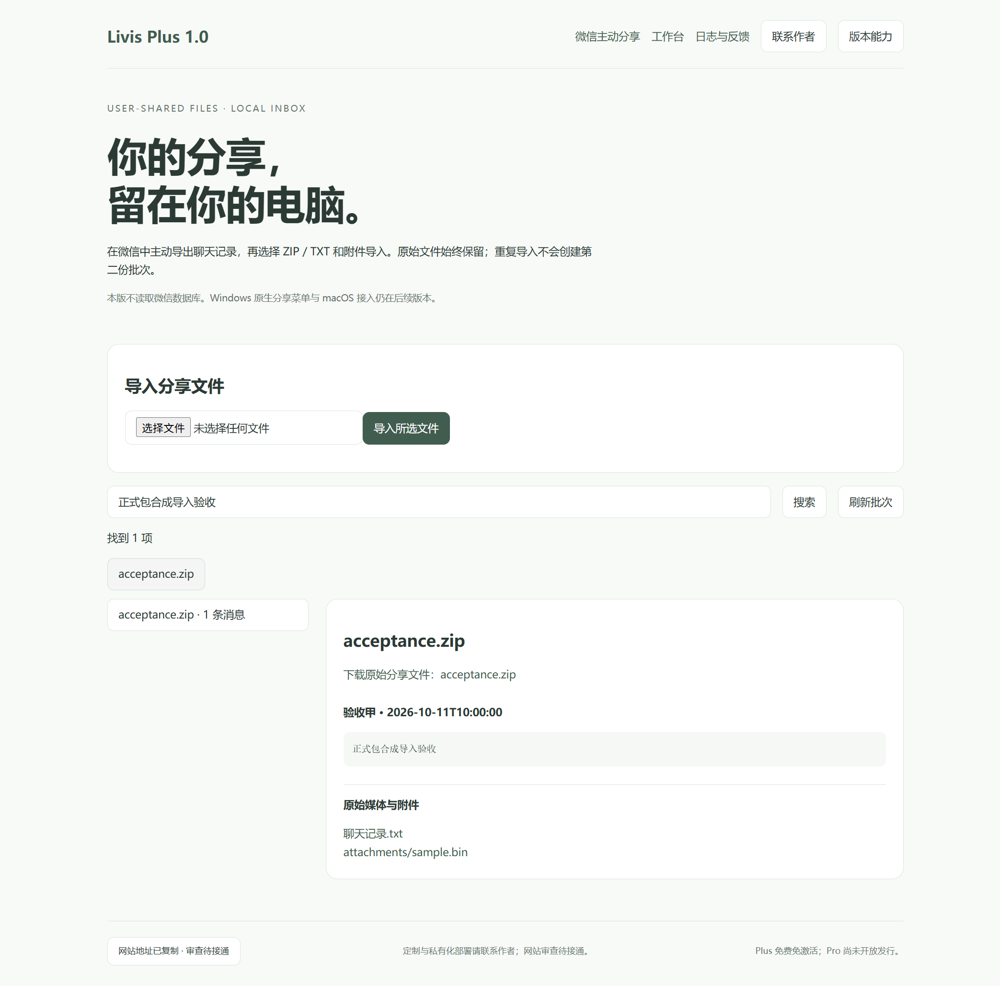

# Livis · 黎维斯

### 下载后，资料留在你的电脑里。

Windows x64 本地应用：导入你主动选择的资料，搜索聊天内容和附件，把需要的上下文接回 Livis 工作台。

[**打开最新下载页**](https://download.yulitongxing.com/#livis) · [使用说明](docs/getting-started.md) · [问题反馈](https://github.com/Destined-at-Dawn/livis/issues)

当前下载入口由与黎同行官网维护。版本、SHA-256 和安装说明以下载页为准。

截图使用合成测试资料，不是真实聊天。

## 下载后能做什么

- **保留原件。** 导入 ZIP、TXT 和附件，原文件与解析结果分开保存。
- **查找记录。** 对已识别的聊天文本按会话、发言人和关键词搜索；无法识别的原件仍会保留。
- **接回插件。** 付费插件在 Livis 内单独导入和授权。统一聊天记录读取器支持微信、QQ、飞书、钉钉和企业微信的统一导入格式。
- **保护本机数据。** Livis 不把聊天数据放进公开下载页，也不把用户文件、账号凭据或设备环境打进安装包。

## 三步开始

1. 打开[最新下载页](https://download.yulitongxing.com/#livis)，核对版本和 SHA-256 后下载 Windows 安装包。
2. 安装并启动 Livis，选择本机数据保存位置，再导入你主动选择的资料。
3. 需要额外能力时，在 Livis 的“插件库”导入已签名插件，并按页面说明完成授权。

官网当前的静态下载页只负责展示稳定版和使用说明。账号注册、订单关联、兑换和设备绑定以授权服务的线上状态为准，不能通过 README 直接完成。

## 安装后

程序和资料分开保存。实际数据目录由首次启动时选择的位置决定；应用不会把本机聊天库复制到公开仓库或下载页。备份、迁移和故障排查请看[使用说明](docs/getting-started.md)。

## 官方推荐第三方

Livis 目录会显示 [WeChat Local Vault](https://github.com/Destined-at-Dawn/wechat-website) 作为官方推荐第三方工具。它是独立项目，需按上游 README 单独配置；Livis 不把它的源码、Git 元数据或本机环境打进主程序。

## 反馈

请在 [Issues](https://github.com/Destined-at-Dawn/livis/issues) 写 Livis 版本、复现步骤和预期结果，不要上传真实聊天、授权码、设备标识或 API Key。

## 关于这个仓库

这个仓库只提供下载入口、使用说明、示例和问题反馈，不提供应用源码、Git 元数据、用户文件或开发环境。免费使用与开源是两回事。
