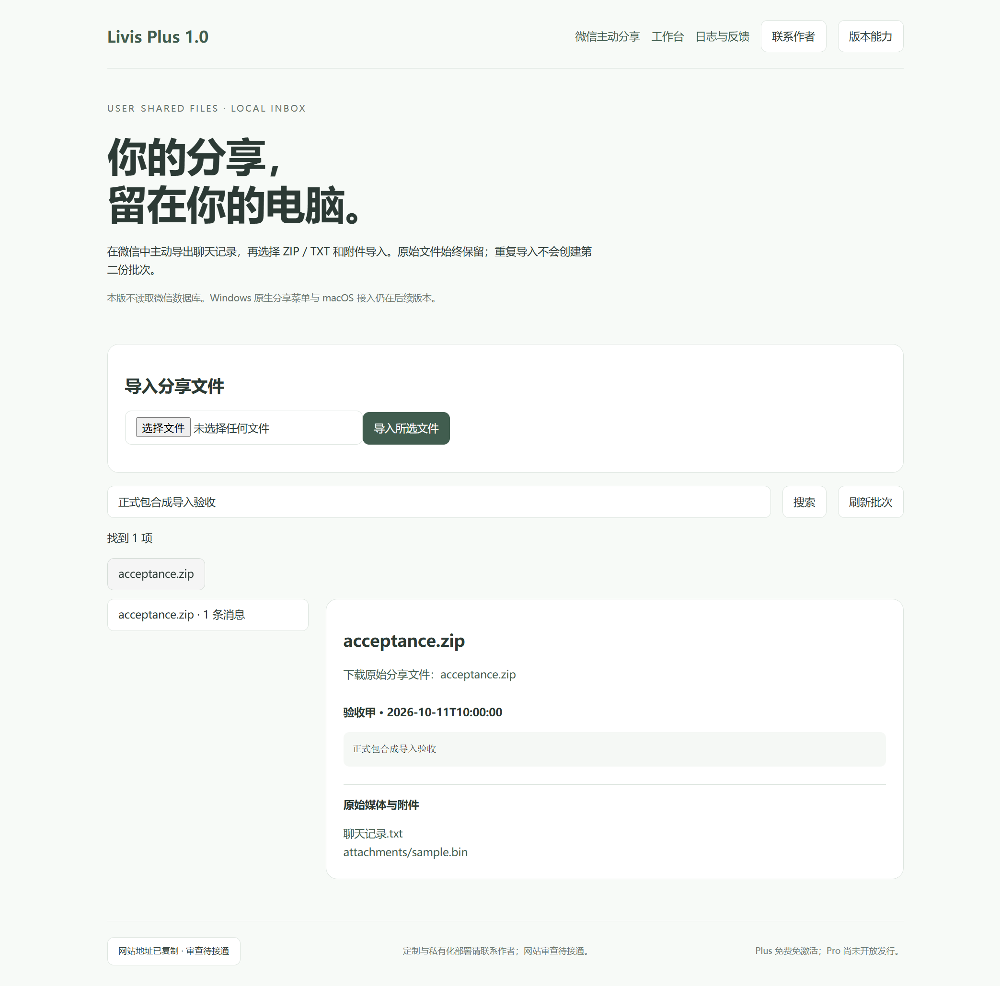

<div align="center">

# Livis · 黎维斯

### 上次那份资料，这次不用再翻群。

把你选好的聊天记录和附件留在电脑上，搜得到消息，也找得到原件。

[**下载 Windows 版**](https://github.com/Destined-at-Dawn/livis/releases/download/v1.1.0/Livis-Plus-v1.1.0-Windows-x64.zip) · [**看在线演示**](https://download.yulitongxing.com/#livis) · [使用说明](docs/getting-started.md) · [问题反馈](https://github.com/Destined-at-Dawn/livis/issues)

Plus 免费 · Windows x64 · 1.1.0



<sub>Windows 程序实际运行截图，画面使用合成测试资料，不是真实聊天。</sub>

</div>

## 用它做什么

老师发的资料、群里的方案、朋友补的一条修改意见，不必只靠记住“是谁、哪天、哪个群发的”。

- **留原件。** 导入 ZIP、TXT 和附件，文件留在电脑里。重复导入同一个文件，不会再建一份批次。
- **找消息。** 聊天文本格式被识别后，可查看发言人、时间和消息；没有识别出来的格式，原文件仍会保留。
- **用不用 AI，都由你。** 导入、保存和搜索不需要模型。想用 AI，再连接自己的本机模型服务或云模型 API。

Plus 处理你主动选好的文件，不读取微信或 QQ 数据库。

## 三步开始

1. [下载 ZIP](https://github.com/Destined-at-Dawn/livis/releases/download/v1.1.0/Livis-Plus-v1.1.0-Windows-x64.zip)，解压后运行 `Livis-Plus-Setup-1.1.0-x64.exe`。
2. 安装免费开源的[微信流 WeChatBridge](https://github.com/freestylefly/WeChatBridge/releases) Windows 版。在微信里右键消息选“多选”，点“合并转发”→“电脑中的应用”→“微信流”。
   打开 Livis Plus 的“微信主动分享”，转发的聊天记录会自动同步进来。**不需要提取密钥，也不读取微信数据库。** 已有 ZIP、TXT 或附件时，也可以直接选择导入。暂时不需要 AI，可以先不用模型。
3. 搜一个关键词，打开记录，查看消息和原件。

不需要激活码。[完整使用说明](docs/getting-started.md)。

**当前是预览版。** 安装、启动和旧公开版升级已检查；真实微信导出兼容性仍在补测。Windows 原生分享菜单、macOS 版和 Pro 下载尚未开放。

## 想先试一下？

示例全部使用虚构人物与内容，解压或下载后即可试导入，不必先拿自己的聊天测试。

| 示例 | 内容 |
| --- | --- |
| [张三 · 私聊 ZIP](examples/张三-私聊.zip) | 聊天文本与附件 |
| [李四 · 私聊 TXT](examples/李四-私聊.txt) | 可识别的聊天文本 |
| [项目讨论群 · 群聊 ZIP](examples/项目讨论群-群聊.zip) | 多人消息与原文件 |

文件名只是示例，程序按导入批次保存，不会据此自动判断私聊或群聊。

## 安装后，文件放在哪里？

程序和资料分开存放。下面的“张三”是示例名，批次标识实际是一串字符。

```text
你选择的安装目录/
├─ Livis Plus.exe
├─ Uninstall Livis Plus.exe
├─ resources/                     # 应用与运行时
└─ locales/、DLL、PAK 等运行文件

%LOCALAPPDATA%/Livis/
├─ data/
│  ├─ Inbox/Ready/<批次标识>/
│  │  ├─ files/张三-私聊.zip        # 导入原件
│  │  ├─ expanded/聊天记录.txt      # ZIP 解包内容
│  │  ├─ manifest.json             # 原件清单
│  │  ├─ derived.json              # 解析结果
│  │  └─ state.json                # 批次状态
│  └─ livis-knowledge.sqlite3
├─ logs/                           # 运行诊断
└─ feedback/                       # 本机导出的反馈包
```

`expanded/` 只在导入 ZIP 时出现，附件沿用 ZIP 中的目录名称。旧公开版升级时可能继续使用 `%LOCALAPPDATA%/LivisPublic/data`。[完整目录、常见文件类型与备份说明](docs/files-and-data.md)。

## 资料与模型

导入的文件和资料库默认留在本机。连接云模型处理某段内容时，这段内容会发给你配置的服务；本机模型需要自行安装、配置，安装包不附带大模型。

支持本机模型，不等于整台电脑永不联网。[查看实际的数据流与组件](docs/architecture.md)。

## 还有一款小软件：团团

在桌边陪你查看 AI 额度的小猫，会呼吸、眨眼、摇尾巴，也能切换成悬浮球。需要与黎站账号查看授权范围内的额度。

[摸摸团团，或下载 Windows 灰度测试版](https://download.yulitongxing.com/#tuantuan)。两款软件独立运行。

## 联系作者

问题请在 [Issues](https://github.com/Destined-at-Dawn/livis/issues) 写版本号、复现步骤和预期结果，不要上传真实聊天或 API Key。应用内诊断包目前导出在本机，需要自行交给作者。

**定制版、企业或学校安装与维护：** [lilanyuan.cn](https://lilanyuan.cn)。

## 关于这个仓库

这里提供下载、使用说明、示例和问题反馈，暂不开放应用源码。免费使用与开源是两回事。

微信主动分享格式参考 [WeChatBridge](https://github.com/freestylefly/WeChatBridge)，许可与来源见[第三方声明](WeChatBridge-notices/THIRD-PARTY-NOTICES.md)。运行时许可随安装程序保留。
